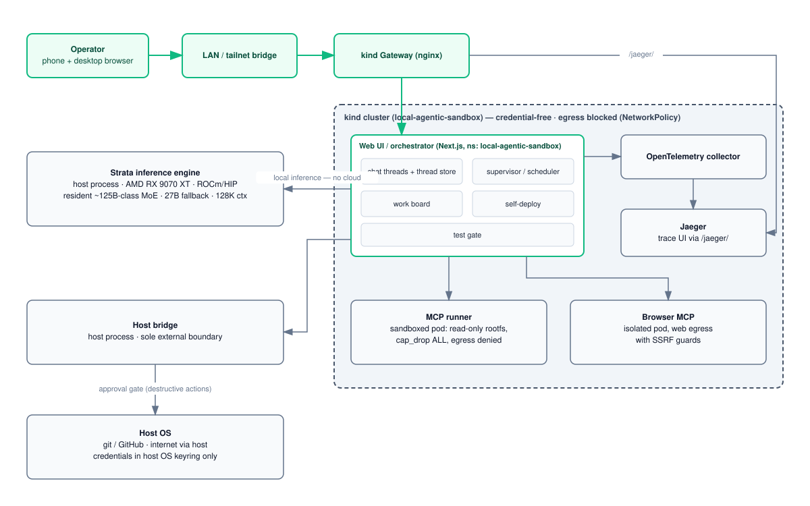

# Architecture Specification: local-agentic-sandbox

**Repository**: `local-agentic-sandbox`  
**Description**: Full-stack, zero-trust autonomous AI coding platform. Orchestrates local LLMs via the Strata inference engine, Model Context Protocol (MCP), and hardened container sandboxes for autonomous code generation, execution, testing, and documentation retrieval.

---

## 1. Executive Summary & Problem Statement

### The Problem

Autonomous AI coding agents need to generate, test, and debug code in real time. Running agent-generated scripts directly on developer workstations or production hosts poses severe security risks: arbitrary execution, credential theft, and network exfiltration.

### The Solution

`local-agentic-sandbox` implements a **zero-trust, multi-boundary containerized architecture**:

1. **Local AI Inference Engine (Strata)**: Self-hosted **Strata inference engine** running on the host GPU (AMD Radeon RX 9070 XT, ROCm/HIP) serving **Qwen3.8-Flash-Next (125B-class MoE)** (`qwen3.8-flash-next-gyro-gyro-s`) at **64K context** (`scripts/start-strata.ps1`), keeping inference local with no cloud dependency. The optional in-cluster Ollama harness (`llm-rocm-gpu`, scaled to 0 by default) can host a 27B fallback (`swift-15-27b-mtp`) when scaled up.
2. **Hardened Execution Boundary (`mcp-server` / `mcp-runner`)**: An unprivileged, read-only container executing 13 autonomous developer and attestation tools over Model Context Protocol (MCP) via **Streamable HTTP (`POST /mcp`, stateless mode)**, strictly sandboxed (`read_only` rootfs, `cap_drop: ALL`, `uid: 10001`, `tmpfs: /tmp (noexec)`).
3. **Isolated Browser Boundary (`browser-mcp`)**: An isolated egress-enabled web scraper and search proxy over Streamable HTTP (`POST /mcp`) with built-in application-layer SSRF protection blocking RFC 1918 subnets, fetching external documentation safely.
4. **Web UI & Autonomous Agent Orchestrator (`web-ui`)**: A Next.js 15 interface featuring real-time conversational chat threads and thread store, a **work board** as a first-class UI surface, supervisor/scheduler, self-deploy (gated OFF by default), test gate, OpenTelemetry distributed tracing waterfall, and persistent session storage on a `10Gi` ReadWriteOnce PVC.
5. **Observability Engine (`otel-collector` / Jaeger)**: Real-time distributed trace collection across agent turns, tool dispatches, and command executions (Jaeger UI exposed via `otel-collector` service port `16686`).
6. **Host Bridge (`host-bridge`)**: Host process acting as the sole external boundary for git/GitHub and host-routed commands, with an approval gate for destructive host actions and shared-secret authentication via host environment variables (`web-ui` mounts internal service tokens via Kubernetes Secrets).

---

## 2. System Architecture & Topology

[](./docs/architecture.drawio.svg)
_Figure 2.1: Full-stack zero-trust architecture across Kubernetes namespace `local-agentic-sandbox`, sandboxed MCP execution boundary, isolated browser scraper, and host GPU inference. Edit source: [docs/architecture.drawio](./docs/architecture.drawio)._

### 2.1 Component Architecture Diagram

```
┌───────────────────────────────────────────────────────────────────────────────────────────────────┐
│                                CLIENT & INGRESS LAYER                                             │
│                                                                                                   │
│   Mobile / Desktop Operator ──► scripts/lan-bridge.js (:80 / :3000)                               │
│                                      │                                                            │
│                                      ▼                                                            │
│                        kind-gateway (nginx :3001, routes / and /jaeger/)                          │
└──────────────────────────────────────────┼────────────────────────────────────────────────────────┘
                                           │
┌──────────────────────────────────────────┼────────────────────────────────────────────────────────┐
│  KUBERNETES CLUSTER (Docker Desktop)     │ Namespace: local-agentic-sandbox                       │
│                                          ▼                                                        │
│   ┌───────────────────────────────────────────────────────────────────────────────────────────┐   │
│   │   Web UI & Agent Orchestrator (Deployment / Service: web-ui:3000 / NodePort 30300)        │   │
│   │   - Next.js 15 / React 19 / TypeScript / Tailwind CSS                                     │   │
│   │   - Model & Thinking Effort: [ Flash-Next / Swift-1.5 · Fast / Balanced / Deep ]          │   │
│   │   - Multimodal Vision Ingestion (image parts via LLM provider on chat route)                │   │
│   │   - Durable Server-Side Persistence (threadStore.ts + SQLite runLedger.ts)                │   │
│   │   - OpenTelemetry Instrumentation SDK (telemetry.ts -> Jaeger trace waterfall)            │   │
│   │   - Local Inference via Host Strata Engine (ROCm/HIP, 128K Context)                       │   │
│   └──────────────────────┬────────────────────────────────────┬───────────────────────────────┘   │
│                          │                                    │                                   │
│           NetworkPolicy: browser-mcp-policy                   │   NetworkPolicy: mcp-runner       │
│           (Allow HTTP/HTTPS :80/:443; SSRF blocked)           │   (CoreDNS :53 + GitHub :443 only)│
│                          │                                    │                                   │
│                          ▼                                    ▼                                   │
│   ┌──────────────────────────────────────────────┐     ┌──────────────────────────────────────┐   │
│   │ Browser MCP Service (browser-mcp:8081)       │     │ MCP Runner Service (mcp-runner:8080) │   │
│   │ - Isolated Web Scraper & DuckDuckGo Search   │     │ - 13 Autonomous Developer &          │   │
│   │ - Built-in SSRF Guard (blocks RFC 1918)      │     │   Attestation Tools                  │   │
│   │ - HTML-to-Clean-Markdown Processor           │     │ - Argv-Safe Git Execution (No Shell) │   │
│   │ - user: 10002:10002 | read-only app          │     │ - ReDoS-Guarded Regex Search         │   │
│   └──────────────────────┬───────────────────────┘     │ - user: 10001:10001 | cap_drop: ALL  │   │
│                          │                             │ - read_only rootfs | tmpfs /tmp      │   │
│                          │                             └──────────────────┬───────────────────┘   │
│                          ▼                                                │                       │
│                   Public Internet                                         ▼                       │
│              (Docs, GitHub, Web Pages)                       ┌───────────────────────────────┐    │
│                                                              │ Workspace Persistent Volume   │    │
│                                                              │ (./workspace:/workspace:rw)   │    │
│                                                              │ - Git Repo & Feature Branches │    │
│                                                              │ - .agent/skills/ Hermes Loop  │    │
│                                                              └───────────────────────────────┘    │
│   ┌───────────────────────────────────────────────────────────────────────────────────────────┐   │
│   │ Distributed Tracing Engine (Deployment: otel-collector:4318, 4317, 16686)                │   │
│   │ - Jaeger UI & Trace Waterfall Analytics for user turns & tool executions                  │   │
│   └───────────────────────────────────────────────────────────────────────────────────────────┘   │
└──────────────────────────────────────────┬────────────────────────────────────────────────────────┘
                                           │ (strata-service / host.docker.internal:8080)
┌──────────────────────────────────────────▼────────────────────────────────────────────────────────┐
│  HOST INFERENCE & BRIDGE BOUNDARY (AMD Radeon RX 9070 XT / ROCm/HIP)                              │
│                                                                                                   │
│   Strata Inference Engine (Host Process)                                                          │
│   └── Qwen3.8-Flash-Next (125B-class MoE) ── Resident Coding Engine (128K context)                │
│       (Optional in-cluster Ollama harness, llm-rocm-gpu :11434, scaled to 0, hosts 27B fallback)  │
│                                                                                                   │
│   Host Bridge (Host Process — Sole External Boundary)                                             │
│   └── git / GitHub, internet via host, approval gate for destructive actions, host OS keyring     │
└───────────────────────────────────────────────────────────────────────────────────────────────────┘
```

---

## 3. Network & Security Isolation Matrix

| Component / Pod      | Placement               | Filesystem Mode       | Linux Capabilities  | User ID           | Role & Network Isolation                                                                                                                                                                                                                                                       |
| :------------------- | :---------------------- | :-------------------- | :------------------ | :---------------- | :----------------------------------------------------------------------------------------------------------------------------------------------------------------------------------------------------------------------------------------------------------------------------- |
| **`mcp-runner`**     | `local-agentic-sandbox` | **`read_only: true`** | **`cap_drop: ALL`** | **`10001:10001`** | Air-Gapped Code Execution. NetworkPolicy: Deny-all egress except CoreDNS (`:53`) and GitHub HTTPS (`:443`).                                                                                                                                                                    |
| **`browser-mcp`**    | `local-agentic-sandbox` | Read-Only App         | Default (No Privs)  | **`10002:10002`** | Isolated Web Scraper & DuckDuckGo Search. Built-in SSRF guard blocking RFC 1918 private subnets. NetworkPolicy: HTTP/HTTPS outbound egress only.                                                                                                                               |
| **`web-ui`**         | `local-agentic-sandbox` | Read-Write            | Default             | Non-Root          | Next.js 15 Web Portal, Work Board & Multi-MCP Dispatcher (Port 3000 / NodePort 30300). NetworkPolicy: Egress allowed to internal MCP services, Jaeger, host Strata engine, and host bridge.                                                                                    |
| **`otel-collector`** | `local-agentic-sandbox` | Ephemeral             | Default (No Privs)  | Non-Root          | Distributed Jaeger Tracing Engine (Ports 4318, 4317, 16686).                                                                                                                                                                                                                   |
| **`strata`**         | Host Process / PCIe     | Local Drive           | Host Native         | Host User         | Local GPU Inference (AMD Radeon RX 9070 XT, ROCm/HIP): resident Qwen3.8-Flash-Next (125B-class MoE), 64K context (`scripts/start-strata.ps1`). The 27B fallback (`swift-15-27b-mtp`) lives on the optional in-cluster Ollama harness (`llm-rocm-gpu`, scaled to 0 by default). |
| **`host-bridge`**    | Host Process            | Local Drive           | Host Native         | Host User         | Sole external boundary (git/GitHub, host-routed commands, approval gate for destructive actions, shared secret via host environment variables).                                                                                                                                |

### 3.1 Host-Filesystem Write Trust Boundary (`./workspace:/workspace:rw`)

The MCP toolchain container mounts the host directory `./workspace` into `/workspace` with read-write access (`:rw`):

- **Design Rationale**: This direct bind mount enables seamless local pair programming. Code files, git feature branches, test suites, architecture diagrams (`.drawio.svg`), and learned agent skills (`.agent/skills/`) generated by the model are written directly to the host filesystem so the developer can review, inspect, and run them locally without manual exports.
- **Trust Implications & Blast Radius**:
  - Any tool execution by the autonomous agent (`workspace_write_file`, `workspace_run_command`) operates directly on files inside `./workspace` with the permissions of the host process running Docker.
  - While path traversal outside `/workspace` is strictly rejected by `resolveSafePath()` and container root is read-only, **any file within `./workspace` can be modified or overwritten** by the agent or by commands executed via `workspace_run_command`.
  - **Operational Hardening**:
    1. Never symlink sensitive host directories (such as `~/.ssh`, `~/.aws`, `~/.kube`, or system credentials) into `./workspace`.
    2. Treat `./workspace` as an untrusted code sandbox that is monitored via version control. Git initializes an automatic repository with commit history inside `./workspace` to allow tracking and reverting agent modifications.

### 3.2 LAN Reverse Proxy Bridge Security Tradeoff

The LAN reverse proxy bridge (`scripts/lan-bridge.js`) binds to `0.0.0.0` on ports `80`, `443`, and `3000` (proxying to `kind-gateway` at `127.0.0.1:3001`) without authentication:

- **Owner Decision**: Unrestricted access across the local home area network allows seamless pairing from mobile phones and tablets via simple browser bookmarks without authentication friction.
- **Blast Radius**: Any device on the home LAN (guests, personal phones, IoT devices) can access the Web UI and drive `workspace_run_command`. Execution is strictly restricted to the containerized `/workspace` sandbox under UID `10001` with no host-level privileges.
- **Startup Warning**: On launch, the bridge emits an explicit security notice in console logs referencing the documentation.

---

## 4. Repository Structure

```text
local-agentic-sandbox/
├── README.md                           # Project overview, quickstart & security matrix
├── ARCHITECTURE.md                     # System architecture specification & threat model
├── package.json                        # Root npm workspace configuration & test scripts
├── docker-compose.yml                  # Docker Compose multi-container deployment
├── Makefile                            # Make orchestration targets (up, down, test, pull)
├── deploy/
│   ├── helm/
│   │   └── local-agentic-sandbox/      # Helm chart for Kubernetes deployment
│   │       ├── Chart.yaml
│   │       ├── values.yaml             # Configurable values (GitHub CIDRs, replicas, ports)
│   │       └── templates/              # Kubernetes templates (deployments, services, network policies)
│   └── k8s/
│       ├── kustomization.yaml          # Kustomize manifest for Docker Desktop Kubernetes
│       ├── namespace.yaml              # Namespace definition: local-agentic-sandbox
│       ├── web-ui.yaml                 # Next.js UI deployment & NodePort service
│       ├── mcp-runner.yaml             # Air-gapped code runner deployment & service
│       ├── browser-mcp.yaml            # SSRF-guarded browser scraper deployment & service
│       ├── strata-service.yaml         # Service pointing to host Strata engine (:8080)
│       ├── host-runner-service.yaml    # Service pointing to host-bridge (:8765)
│       ├── qdrant.yaml                 # Qdrant vector store deployment & service
│       ├── builder-tier.yaml           # Builder-tier NetworkPolicy & config (no standalone pod deployed)
│       ├── ingress.yaml                # Nginx ingress rules for web-ui
│       ├── observability.yaml          # Jaeger OpenTelemetry collector deployment & service
│       ├── network-policies.yaml       # Zero-trust network egress & ingress policies
│       └── workspace-pvc.yaml          # Standard 10Gi ReadWriteOnce persistent volume claim for /workspace
├── docs/
│   ├── architecture.drawio                          # Editable Draw.io XML source diagram
│   ├── architecture.drawio.svg                      # Rendered vector SVG diagram for README/docs
│   ├── architecture.svg                             # Companion vector SVG diagram
│   ├── AI_GOVERNANCE.md                             # NIST AI RMF 1.0 & OWASP Agentic Top 10 controls
│   ├── KUBERNETES_DEPLOYMENT.md                     # Docker Desktop K8s deploy & access guide
│   ├── MODEL_RESIDENCY.md                           # Host Strata model roster & residency policy
│   ├── ADR-001-sandboxed-mcp.md                     # Architectural Decision Record: sandboxed MCP
│   ├── ADR-002-langgraph-supervisor-checkpoints.md  # Architectural Decision Record: LangGraph checkpoints
│   ├── access-path.md                               # LAN / tailnet bridge & kind-gateway ops guide
│   ├── live-e2e.md                                  # Live cluster acceptance test battery (L1-L8)
│   ├── resource-budgets.md                          # VRAM, cache, and two-tier sandbox budgets
│   ├── topology-matrix.md                           # Component, port, and communication matrix
│   └── images/                                      # README & UI showcase screenshots
├── host-bridge/                        # Host-side tool bridge (sole external boundary, :8765)
├── eval/                               # Graded evaluation suite for chunked job execution
├── scripts/
│   ├── deploy-cluster.js               # Docker build, containerd import, K8s rollout & verify
│   ├── test-gate.js                    # Change-aware local test gate CLI wrapper
│   ├── kind-gateway/                   # nginx:alpine gateway container & SSE proxy config (:3001)
│   ├── lan-bridge.js                   # Zero-auth LAN reverse proxy bridge (0.0.0.0:80 / :3000)
│   └── test-ui-render.js               # Headless visual inspection test script
├── browser-mcp/
│   ├── Dockerfile
│   ├── package.json
│   ├── src/                            # SSRF protection, DuckDuckGo search, HTML cleaning
│   └── tests/                          # Automated SSRF and HTML parser tests
├── mcp-server/
│   ├── Dockerfile
│   ├── package.json
│   ├── tsconfig.json
│   ├── src/
│   │   ├── index.ts                    # Streamable HTTP (POST /mcp) transport & tool registry
│   │   └── tools/
│   │       ├── codeRunner.ts           # Sandboxed Python execution & kernel attestation
│   │       ├── attestation.ts          # Runtime /proc/self/status boundary verification (reports SCOUT_CLI_UNAVAILABLE when Scout CLI absent)
│   │       ├── patchCore.ts            # Surgical file patch engine for workspace_patch_file
│   │       └── workspaceTools.ts       # 10 argv-safe git & filesystem tools (ReDoS guarded; 13 MCP tools total)
│   └── tests/                          # Unit & security integration tests
├── web-ui/
│   ├── Dockerfile
│   ├── package.json
│   ├── tsconfig.json
│   ├── tailwind.config.ts
│   ├── app/
│   │   ├── layout.tsx
│   │   ├── page.tsx                    # Main portal: tabs, persistent state, live telemetry
│   │   └── api/
│   │       ├── board/route.ts          # Persisted work board CRUD API
│   │       ├── chat/route.ts           # Streaming agent turn orchestrator, MCP tool loop & compaction
│   │       ├── tasks/route.ts          # Autonomous task decomposition & lifecycle API
│   │       ├── threads/route.ts        # Durable thread persistence & execution dispatch
│   │       └── sandbox-status/route.ts # Live container security health probe
│   ├── components/
│   │   ├── BoardView.tsx               # 5-column work board UI (Queued, Working, PR Open, Parked, Done)
│   │   ├── ChatStream.tsx              # Interactive conversational chat interface
│   │   ├── ModelBottomSheet.tsx        # Model & thinking effort bottom sheet control
│   │   ├── ExecutionTrace.tsx          # Real-time tool execution & agent steps
│   │   ├── TraceWaterfall.tsx          # OpenTelemetry Jaeger distributed trace visualizer
│   │   ├── SandboxGauge.tsx            # Visual security boundary posture indicator
│   │   ├── DiffViewer.tsx              # Side-by-side git diff viewer
│   │   └── ThreadsSidebar.tsx          # Material 3 responsive sessions sidebar
│   ├── lib/
│   │   ├── board/dispatcher.ts         # Board drain dispatcher with shadow-mode auto-issue gate
│   │   ├── testGate.ts                 # Change-aware local test gate & Playwright runner
│   │   ├── threads/threadStore.ts      # Server-side durable thread store
│   │   ├── fileParser.ts               # File ingestion & multimodal base64 extractor
│   │   ├── ledger/runLedger.ts         # SQLite-backed durable run ledger & lifecycle tracking
│   │   ├── subagents/supervisor.ts     # LangGraph supervisor, fail-closed recovery, and watchdog
│   │   ├── subagents/workerPool.ts     # Builder & Critic worker pool with AST pre-validation
│   │   ├── subagents/llmClient.ts      # Scoped context scaling & <think> stream parser
│   │   ├── telemetry.ts                # OpenTelemetry SDK span generation & Jaeger export
│   │   ├── toolParser.ts               # XML/JSON tool call extractor & tag cleaner
│   │   └── subagents/morningReport.ts  # Morning report & drain report markdown formatting
│   └── tests/                          # 1,930 unit and contract tests across 283 files
└── workspace/                          # Sandboxed host directory mounted to /workspace:rw
```

---

## 5. Verification & Quickstart

### 5.1 Kubernetes Deployment (Docker Desktop / Local Cluster)

All platform workloads reside inside the dedicated `local-agentic-sandbox` namespace:

```bash
# 1. Automated build, containerd import, rollout, and verification (recommended)
node scripts/deploy-cluster.js web-ui

# OR: Apply manifests via Kustomize / Helm
kubectl apply -k deploy/k8s
helm install local-agentic-sandbox deploy/helm/local-agentic-sandbox -n local-agentic-sandbox --create-namespace

# 2. Verify all pods and services in the local-agentic-sandbox namespace
kubectl get all -n local-agentic-sandbox

# 3. Access Web UI (LAN/gateway bridge on :3001 -> :30300, or port-forward)
kubectl port-forward svc/web-ui -n local-agentic-sandbox 3001:3000 --address 0.0.0.0
```

> **Note**: Docker Desktop's GUI dashboard filters by the `default` namespace by default. Always specify `-n local-agentic-sandbox` when inspecting cluster workloads via CLI or select the `local-agentic-sandbox` namespace dropdown in Docker Desktop.

### 5.2 Test Verification & Compose Harness

```bash
# 1. Typecheck web-ui
npx tsc --noEmit -p web-ui/tsconfig.json

# 2. Run workspace unit/contract suites (1,930 unit and contract tests across 283 files in web-ui)
npm test

# 3. Run the change-aware local test gate or full Playwright suite (284 tests across 13 spec files and 4 projects)
npm run test:gate
npm --prefix web-ui run test:e2e

# 4. Standalone Docker Compose container verification (legacy local harness)
make up
make verify-sec
```
