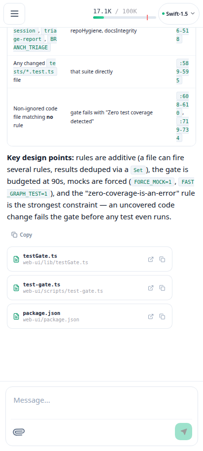
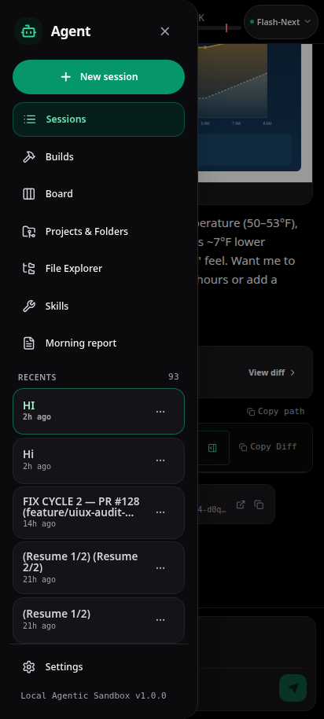
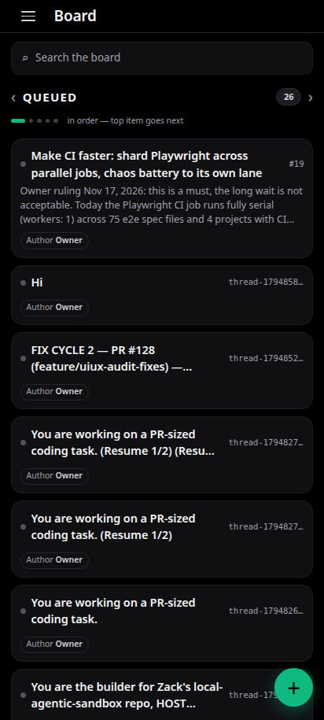
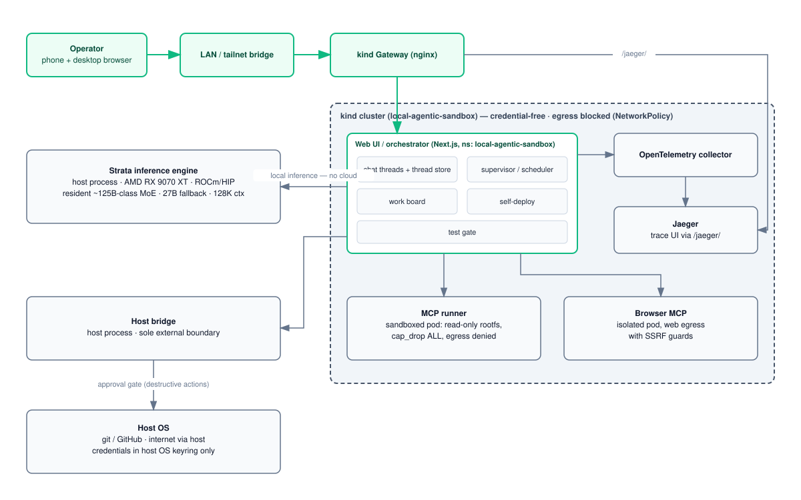

# local-agentic-sandbox

**A local autonomous AI coding platform.** Hand it an engineering task in the evening, and it plans the work, writes the code in small verified patches, runs the tests, opens the pull request, deploys itself, and proves the result — overnight, on one consumer PC, with no cloud inference, no API keys in the cluster, and no per-token meter.


| Mobile chat | Navigation | Work board |
| :---: | :---: | :---: |
|  |  |  |

---

## What it is

`local-agentic-sandbox` is a self-hosted agentic engineering system built around one idea: **an AI that does real work must be verifiable.** Every job runs as a chat thread, is decomposed into small per-file patches that are committed as they land, and is gated by tests and CI before anything merges. The cluster that runs it holds no credentials and has no internet egress; the only path out is a host-side bridge with approval gates for destructive actions.

- **Threads are the job container** — a conversation is the unit of work: prompt, plan, patches, checkpoints, and deliverables all live in one durable thread that survives restarts and streams live to phone and desktop at the same time.
- **Patches, not blobs** — long jobs are chunked into small, individually committed patches with durable checkpoints and handoffs, so a killed session resumes instead of restarting.
- **Fail-closed verification** — a change-aware local test gate, a five-job CI pipeline, an invariant test net, and an adversarial "chaos" battery (overflow inputs, stop/start abuse, unhappy paths) stand between a model's output and `develop`.
- **A work board, not a black box** — queued, working, and done items are visible and editable in the UI; the operator can steer, stop (stop aborts the server-side turn), and inspect everything from a phone.
- **Full observability** — every agent turn is an OpenTelemetry trace (a real 51-span turn is shown below), viewable in Jaeger.
- **Local inference** — a ~125B-class MoE model served on the host GPU (AMD RX 9070 XT, ROCm/HIP) with a `swift-15-27b-mtp` (27B Q3_K_M with Multi-Token Prediction) fallback; 128K context. Nothing leaves the machine.


---

## Architecture



### Key Engineering Proofs (Code Map)

| System Subsystem | Implementation Proof | Key Capabilities |
| :--- | :--- | :--- |
| **Fail-Closed Supervisor** | [`web-ui/lib/subagents/supervisor.ts`](./web-ui/lib/subagents/supervisor.ts) | LangGraph checkpoint engine, crash recovery, crash-to-disk sync, and multi-subagent orchestration |
| **Pre-Validation & Gates** | [`web-ui/lib/subagents/workerPool.ts`](./web-ui/lib/subagents/workerPool.ts) | AST pre-validation, stuck detection, zero-change gate, and test-regression rollback |
| **Context & Thinking Stream** | [`web-ui/lib/subagents/llmClient.ts`](./web-ui/lib/subagents/llmClient.ts) | Scope-aware context scaling (`PROJECT` 8192 vs `SCRIPT`/`SNIPPET` 4096) and real-time `<think>` parser |
| **Durable Run Ledger** | [`web-ui/lib/ledger/runLedger.ts`](./web-ui/lib/ledger/runLedger.ts) | SQLite-backed task state, pause/resume lifecycle, and restart lineage |
| **Safe Git Operations** | [`web-ui/lib/git/workerGitOps.ts`](./web-ui/lib/git/workerGitOps.ts) | Argv-safe git commands, branch isolation, and commit validation immune to shell injection |
| **Self-Deploy Pipeline** | [`web-ui/lib/deploy/selfDeploy.ts`](./web-ui/lib/deploy/selfDeploy.ts) | Automated Docker build, image push, Kubernetes rollout wait, and rollback on failure |
| **Zero-Trust MCP Toolchain** | [`mcp-server/src/tools/workspaceTools.ts`](./mcp-server/src/tools/workspaceTools.ts) | Hardened execution boundary, path traversal guards, and ReDoS-safe workspace inspection |
| **Enterprise AI Governance** | [`docs/AI_GOVERNANCE.md`](./docs/AI_GOVERNANCE.md) | Deterministic runtime enforcement, NIST AI RMF 1.0 mapping, and OWASP Agentic Top 10 controls |

| Component | Where | Role |
| :--- | :--- | :--- |
| **Web UI / orchestrator** | `web-ui/` (Next.js, kind cluster) | Chat threads, supervisor and scheduler, the work board, self-deploy, the test gate (`web-ui/lib/testGate.ts`) |
| **Supervisor** | `web-ui/lib/subagents/supervisor.ts` | Checkpointed multi-agent loop: plan → build → verify, crash recovery from durable checkpoints |
| **Thread store** | `web-ui/lib/threads/threadStore.ts` | Durable thread records; stat-based cheap sweeps keep the server responsive at hundreds of threads |
| **Host bridge** | `host-bridge/` (host process) | The sole external boundary: host tools, git/GitHub, internet access — behind an approval classifier; credentials live only in the host OS keyring |
| **MCP runner** | `mcp-server/` (sandboxed pod) | Filesystem/command/test tools in a read-only, capability-dropped, egress-denied container |
| **Browser MCP** | `browser-mcp/` (isolated pod) | Web retrieval with SSRF guards (RFC 1918 blocked) |
| **Observability** | `deploy/k8s/observability.yaml` | OpenTelemetry collector + Jaeger; every turn, tool call, and model round is a span |
| **Eval pack** | `eval/` | Graded task suite used as the end-to-end regression for chunked job execution |

### Security boundary

- The Kubernetes cluster is **credential-free and egress-blocked** by NetworkPolicy. It cannot reach the internet and holds no tokens.
- The **host bridge is the only way out**, and destructive host actions require explicit approval through its classifier.
- The web UI is a single-tenant LAN appliance by design (no auth on API routes); it is not exposed to the public internet.

Full specification: [ARCHITECTURE.md](ARCHITECTURE.md) · Governance mapping: [docs/AI_GOVERNANCE.md](docs/AI_GOVERNANCE.md)

---

## How a job runs

1. **Intake** — a task arrives as a thread (typed, or filed on the board).
2. **Plan** — the supervisor decomposes it into milestones with checkable acceptance criteria.
3. **Build in patches** — the builder lands small per-file patches, each committed as it lands; checkpoints persist at every transition.
4. **Verify** — the change-aware test gate runs the affected tests; CI runs the full five jobs (typecheck, unit, coverage, container, Playwright) plus the invariant net.
5. **Ship** — green work merges to `develop` by pull request, the platform deploys itself to the local cluster, and the deploy is verified live (pod health, gateway, API) before the item is called done.
6. **Report** — a morning report summarizes milestones, commits, test evidence, and anything flagged for human review.

## Running it

Prerequisites: Docker Desktop with Kubernetes (kind), Node 22, and a local inference server on the host GPU.

```bash
# Deploy the web UI to the local cluster (builds, imports, rolls out, verifies)
node scripts/deploy-cluster.js web-ui

# Cluster state
kubectl get pods -n local-agentic-sandbox
```

The UI is served on the LAN through the cluster gateway; the same session is live on phone and desktop simultaneously.

## Testing

```bash
cd web-ui
npm test            # 1,600+ unit and contract tests
npm run test:gate   # change-aware gate: runs exactly the tests a change touches
npm run test:e2e    # Playwright suite (75 spec files, 4 projects)
```

The gate is strict on purpose: a changed file with no test coverage is rejected outright, and e2e specs run under the real Playwright runner. CI additionally runs an invariant net and a chaos battery that hammers the unhappy paths — mid-stream stops, overflow inputs, type-confused payloads.

---

## Project layout

| Path | Contents |
| :--- | :--- |
| `web-ui/` | Next.js operator UI + orchestration engine |
| `host-bridge/` | Host-side tool bridge (the external boundary) |
| `mcp-server/`, `browser-mcp/` | Sandboxed tool servers |
| `deploy/` | Kubernetes manifests + Helm chart |
| `eval/` | Graded evaluation tasks |
| `docs/` | Architecture source, ADRs, governance, deployment notes |

## Status

v1.0.0 — in daily use as both a working system and a portfolio piece. Designed, directed, and reviewed end-to-end by the author; implementation was AI-assisted under a test-first process (failing test first, explicit acceptance criteria, every diff audited before merge). See [LICENSE](LICENSE).
