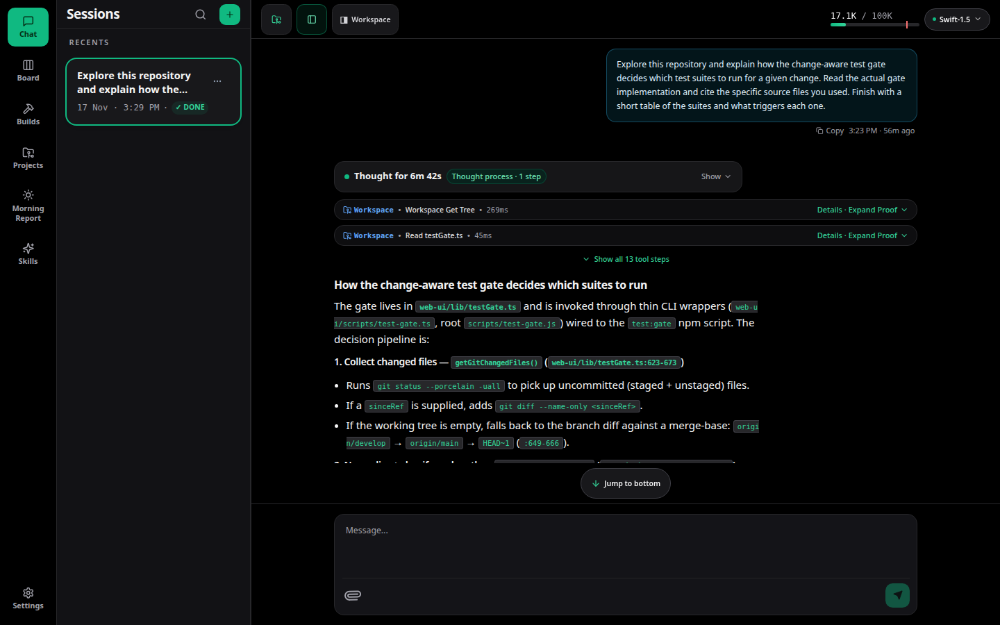
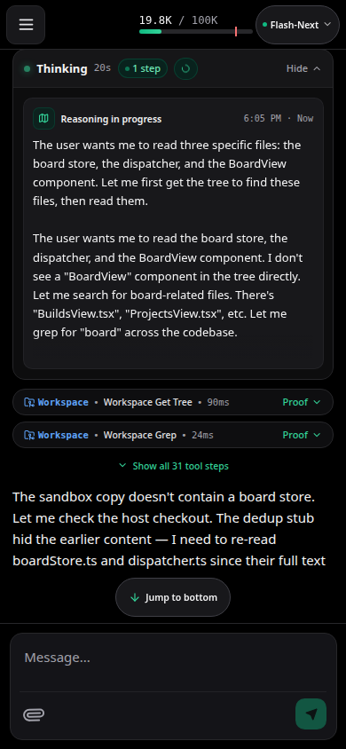
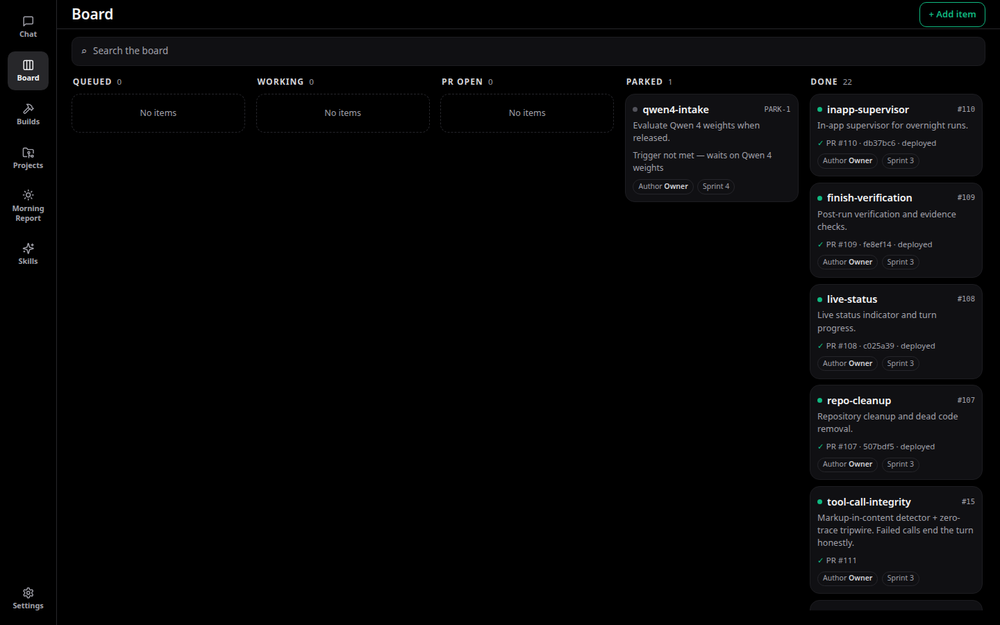
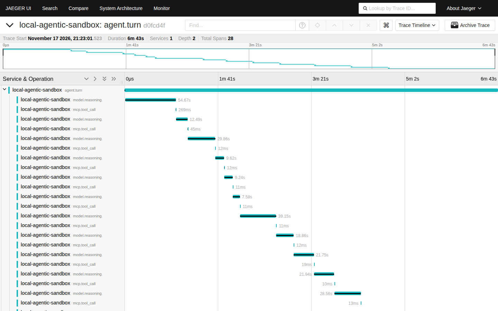

# local-agentic-sandbox

**A local autonomous AI coding platform.** Hand it an engineering task in the evening, and it plans the work, writes the code in small verified patches, runs the tests, opens the pull request, deploys itself, and proves the result — overnight, on one consumer PC, with no cloud inference, no API keys in the cluster, and no per-token meter.



|                                           Mobile chat                                            |                                                 Live turn                                                  |                                                            Navigation                                                            |                                             Work board                                             |
| :----------------------------------------------------------------------------------------------: | :--------------------------------------------------------------------------------------------------------: | :------------------------------------------------------------------------------------------------------------------------------: | :------------------------------------------------------------------------------------------------: |
|  |  |  |  |



---

## Contents

- [What it is](#what-it-is)
- [Architecture](#architecture)
  - [Key Engineering Proofs (Code Map)](#key-engineering-proofs-code-map)
  - [Security boundary](#security-boundary)
  - [Observability](#observability)
- [How a job runs](#how-a-job-runs)
- [Running it](#running-it)
  - [Prerequisites](#prerequisites)
  - [Deploy](#deploy)
  - [Access](#access)
- [Testing](#testing)
  - [Local suites](#local-suites)
  - [CI and the invariant net](#ci-and-the-invariant-net)
- [Documentation](#documentation)
- [Project layout](#project-layout)
- [Status](#status)

---

## What it is

`local-agentic-sandbox` is a self-hosted agentic engineering system built around one idea: **an AI that does real work must be verifiable.** Every job runs as a chat thread, is decomposed into small per-file patches that are committed as they land, and is gated by tests and CI before anything merges. `web-ui` has zero external internet egress; `browser-mcp` is an isolated SSRF-guarded web-fetch pod (`:80`/`:443`); `mcp-runner` may reach GitHub CIDRs on `:443` only; credentials live only in the host OS keyring behind the host bridge.

- **Threads are the job container** — a conversation is the unit of work: prompt, plan, patches, checkpoints, and deliverables all live in one durable thread that survives restarts and streams live to phone and desktop at the same time.
- **Patches, not blobs** — long jobs are chunked into small, individually committed patches with durable checkpoints and handoffs, so a killed session resumes instead of restarting.
- **Fail-closed verification** — a change-aware local test gate, a seven-check CI pipeline, an invariant test net, and an adversarial "chaos" battery (overflow inputs, stop/start abuse, unhappy paths) stand between a model's output and `develop`.
- **A work board, not a black box** — queued, working, and done items are visible and editable in the UI; the operator can steer, stop (stop aborts the server-side turn), and inspect everything from a phone.
- **Full observability** — every agent turn is an OpenTelemetry trace (a real 28-span turn is shown below), viewable in Jaeger.
- **Local inference** — **Strata** inference engine on the host GPU (AMD RX 9070 XT, ROCm/HIP), serving **Qwen3.8-Flash-Next (125B-class MoE)** (`qwen3.8-flash-next-gyro-gyro-s`), 128K context, with `swift-15-27b-mtp` fallback. Nothing leaves the machine.



---

## Architecture


### Key Engineering Proofs (Code Map)

| System Subsystem              | Implementation Proof                                                                 | Key Capabilities                                                                                                                                           |
| :---------------------------- | :----------------------------------------------------------------------------------- | :--------------------------------------------------------------------------------------------------------------------------------------------------------- |
| **Fail-Closed Supervisor**    | [`web-ui/lib/subagents/supervisor.ts`](./web-ui/lib/subagents/supervisor.ts)         | LangGraph checkpoint engine, crash recovery, crash-to-disk sync, and multi-subagent orchestration                                                          |
| **Pre-Validation & Gates**    | [`web-ui/lib/subagents/workerPool.ts`](./web-ui/lib/subagents/workerPool.ts)         | AST pre-validation, stuck detection, zero-change gate, and test-regression rollback                                                                        |
| **Context & Thinking Stream** | [`web-ui/lib/subagents/llmClient.ts`](./web-ui/lib/subagents/llmClient.ts)           | Scope-aware context scaling (`PROJECT` 8192 vs `SCRIPT`/`SNIPPET` 4096) and real-time `<think>` parser                                                     |
| **Durable Run Ledger**        | [`web-ui/lib/ledger/runLedger.ts`](./web-ui/lib/ledger/runLedger.ts)                 | SQLite-backed task state, pause/resume lifecycle, and restart lineage                                                                                      |
| **Thread Store**              | [`web-ui/lib/threads/threadStore.ts`](./web-ui/lib/threads/threadStore.ts)           | Durable thread records; stat-based cheap sweeps keep the server responsive at hundreds of threads                                                          |
| **Safe Git Operations**       | [`web-ui/lib/git/workerGitOps.ts`](./web-ui/lib/git/workerGitOps.ts)                 | Argv-safe git commands, branch isolation, and commit validation immune to shell injection                                                                  |
| **Self-Deploy Pipeline**      | [`web-ui/lib/deploy/selfDeploy.ts`](./web-ui/lib/deploy/selfDeploy.ts)               | Automated Docker build, local save/import, Kubernetes `set image` rollout wait, and rollback on failure                                                    |
| **Host Bridge**               | [`host-bridge/`](./host-bridge/)                                                     | Sole external boundary (host process): host tools, git/GitHub, internet access behind an approval classifier; credentials live only in the host OS keyring |
| **Zero-Trust MCP Toolchain**  | [`mcp-server/src/tools/workspaceTools.ts`](./mcp-server/src/tools/workspaceTools.ts) | Hardened execution boundary in a read-only, capability-dropped pod; path traversal guards and ReDoS-safe workspace inspection                              |
| **Browser MCP**               | [`browser-mcp/`](./browser-mcp/)                                                     | Isolated web-fetch pod with SSRF guards (RFC 1918 blocked)                                                                                                 |
| **Observability**             | [`deploy/k8s/observability.yaml`](./deploy/k8s/observability.yaml)                   | OpenTelemetry collector + Jaeger; every turn, tool call, and model round is a span                                                                         |
| **Eval Pack**                 | [`eval/`](./eval/)                                                                   | Graded task suite used as the end-to-end regression for chunked job execution                                                                              |
| **Enterprise AI Governance**  | [`docs/AI_GOVERNANCE.md`](./docs/AI_GOVERNANCE.md)                                   | Deterministic runtime enforcement, NIST AI RMF 1.0 mapping, and OWASP Agentic Top 10 controls                                                              |

### Security boundary

- `web-ui` has **zero external internet egress**; `browser-mcp` is an isolated SSRF-guarded web-fetch pod (`:80`/`:443`); `mcp-runner` may reach GitHub CIDRs on `:443` only (`deploy/k8s/network-policies.yaml`). Credentials live only in the host OS keyring behind the host bridge.
- The **host bridge is the only way out** for host tools and git/GitHub, and destructive host actions require explicit approval through its classifier.
- The web UI is a single-tenant LAN appliance by design (no auth on API routes); it is not exposed to the public internet.

Full specification: [ARCHITECTURE.md](ARCHITECTURE.md) · Governance mapping: [docs/AI_GOVERNANCE.md](docs/AI_GOVERNANCE.md)

### Observability

Every agent turn is an OpenTelemetry trace: the collector receives spans for each model round, tool call, and deploy step, and Jaeger renders the whole turn as one waterfall — a real 28-span turn is pictured above. The manifests live in [`deploy/k8s/observability.yaml`](./deploy/k8s/observability.yaml); the Jaeger UI is reachable on the LAN through the cluster gateway, never on the public internet.

---

## How a job runs

1. **Intake** — a task arrives as a thread (typed, or filed on the board).
2. **Plan** — the supervisor decomposes it into milestones with checkable acceptance criteria.
3. **Build in patches** — the builder lands small per-file patches, each committed as it lands; checkpoints persist at every transition.
4. **Verify** — the change-aware test gate runs the affected tests; CI runs seven checks (typecheck, unit, coverage, container, three Playwright shards) plus the invariant net.
5. **Ship** — green work merges to `develop` by pull request, the platform deploys itself to the local cluster, and the deploy is verified live (pod health, gateway, API) before the item is called done.
6. **Report** — a morning report summarizes milestones, commits, test evidence, and anything flagged for human review.

## Running it

### Prerequisites

Docker Desktop with Kubernetes (kind), Node 22, and a local inference server on the host GPU.

### Deploy

```bash
# Deploy the web UI to the local cluster (builds, imports, rolls out, verifies)
node scripts/deploy-cluster.js web-ui

# Cluster state
kubectl get pods -n local-agentic-sandbox
```

### Access

The UI is served on the LAN through the cluster gateway; the same session is live on phone and desktop simultaneously.

## Testing

### Local suites

```bash
cd web-ui
npm test            # 1,647 unit and contract tests in web-ui (1,681 across workspaces; 1,677 in Linux CI)
npm run test:gate   # change-aware gate: runs exactly the tests a change touches
npm run test:e2e    # Playwright suite (272 tests across 12 spec files and 4 projects)
```

### CI and the invariant net

Every pull request runs seven checks: typecheck, unit tests, coverage, container build, and three Playwright shards. On top of that sit an invariant net (cross-cutting properties the suite must always hold) and a chaos battery that hammers the unhappy paths — mid-stream stops, overflow inputs, type-confused payloads. The gate is strict on purpose: a changed file with no test coverage is rejected outright, and e2e specs run under the real Playwright runner.

---

## Documentation

- [ARCHITECTURE.md](ARCHITECTURE.md) — full system specification, security isolation matrix, and repository layout.
- [docs/AI_GOVERNANCE.md](docs/AI_GOVERNANCE.md) — governance mapping: NIST AI RMF 1.0 and OWASP Agentic Top 10 controls, each tied to its enforcement code.
- [docs/KUBERNETES_DEPLOYMENT.md](docs/KUBERNETES_DEPLOYMENT.md) — deployment and cluster operations guide.
- [docs/MODEL_RESIDENCY.md](docs/MODEL_RESIDENCY.md) — host Strata model roster and GPU residency policy.
- [docs/topology-matrix.md](docs/topology-matrix.md) — component placement, port, and communication matrix.
- [docs/access-path.md](docs/access-path.md) — LAN / tailnet bridge, `kind-gateway`, and auto-healing watchdog.
- [docs/resource-budgets.md](docs/resource-budgets.md) — VRAM, build-cache, and two-tier sandbox budgets.
- [docs/live-e2e.md](docs/live-e2e.md) — live cluster acceptance test battery (`L1`–`L8`).
- [docs/ADR-001-sandboxed-mcp.md](docs/ADR-001-sandboxed-mcp.md) & [docs/ADR-002-langgraph-supervisor-checkpoints.md](docs/ADR-002-langgraph-supervisor-checkpoints.md) — architecture decision records.
- [eval/README.md](eval/README.md) & [eval/CHUNKED-BASELINE.md](eval/CHUNKED-BASELINE.md) — versioned 5-task model evaluation pack and chunked job regression protocol.

## Project layout

| Path                          | Contents                                                |
| :---------------------------- | :------------------------------------------------------ |
| `web-ui/`                     | Next.js operator UI + orchestration engine              |
| `host-bridge/`                | Host-side tool bridge (the external boundary)           |
| `mcp-server/`, `browser-mcp/` | Sandboxed tool servers                                  |
| `deploy/`                     | Kubernetes manifests + Helm chart                       |
| `eval/`                       | Graded evaluation tasks                                 |
| `docs/`                       | Architecture source, ADRs, governance, deployment notes |

## Status

v2.0.0 — in daily use as both a working system and a portfolio piece. Designed, directed, and reviewed end-to-end by the author; implementation was AI-assisted under a test-first process (failing test first, explicit acceptance criteria, every diff audited before merge). See [LICENSE](LICENSE).
